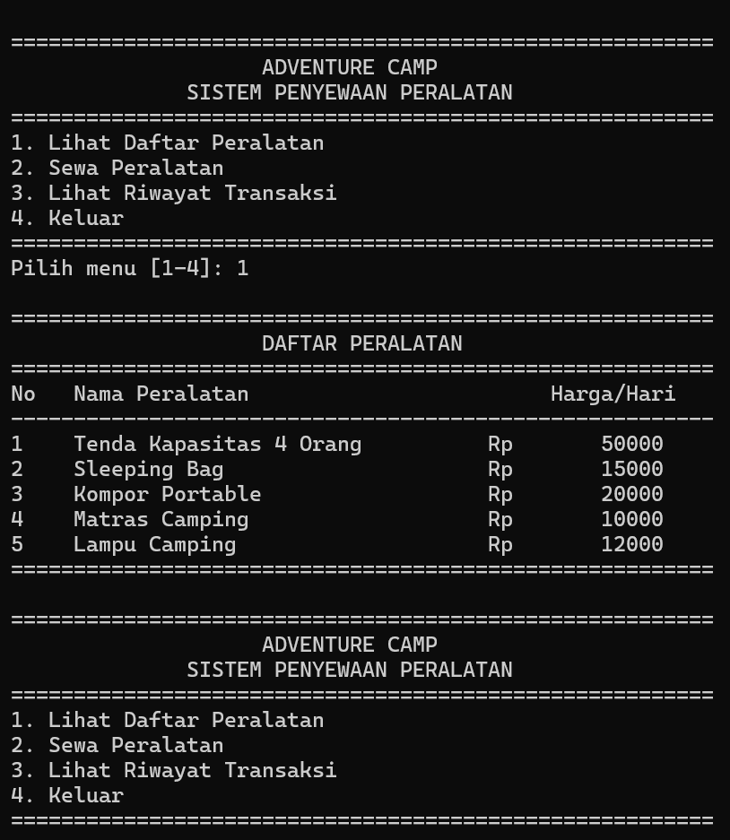
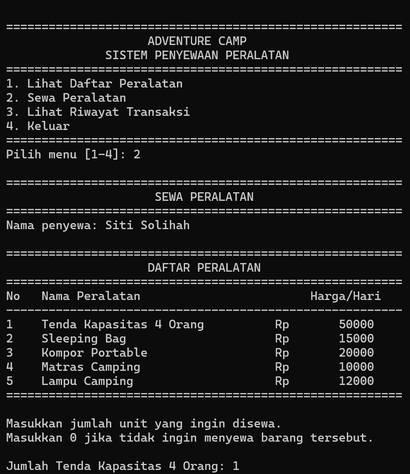
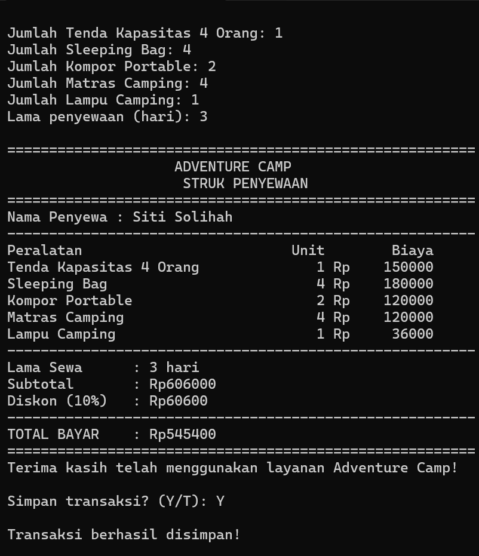
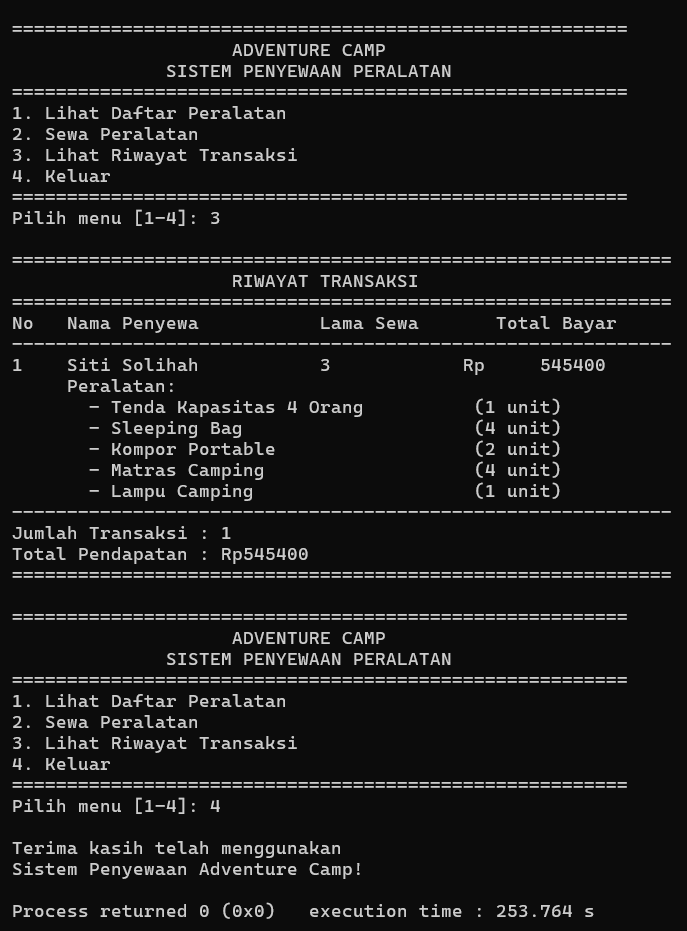

# ADVENTURE CAMP
## Sistem Penyewaan Peralatan Camping

### Identitas Mahasiswa
- **Nama Lengkap:** Siti Solihah
- **NIM:** C2583207029
- **Program Studi:** Pendidikan Teknologi Informasi
- **Universitas:** Universitas Muhammadiyah Tasikmalaya

---

### Deskripsi Program

Adventure Camp adalah aplikasi berbasis console yang dibuat menggunakan bahasa pemrograman C untuk membantu proses penyewaan peralatan camping.

Program ini dirancang untuk mempermudah petugas dalam mengelola penyewaan peralatan, menghitung biaya sewa secara otomatis berdasarkan jenis peralatan, jumlah unit, dan lama penyewaan, serta memberikan diskon sesuai ketentuan yang berlaku.

Program juga menyediakan fitur struk penyewaan dan riwayat transaksi selama aplikasi berjalan.

### Daftar Peralatan dan Harga Sewa

| No. | Nama Peralatan | Harga Sewa per Hari |
|---|---|---:|
| 1 | Tenda Kapasitas 4 Orang | Rp50.000 |
| 2 | Sleeping Bag | Rp15.000 |
| 3 | Kompor Portable | Rp20.000 |
| 4 | Matras Camping | Rp10.000 |
| 5 | Lampu Camping | Rp12.000 |

### Ketentuan Diskon

Diskon diberikan berdasarkan lama penyewaan:

| Lama Penyewaan | Diskon |
|---|---:|
| 1–2 hari | 0% |
| 3–4 hari | 10% |
| 5 hari atau lebih | 15% |

Rumus perhitungan:

- **Subtotal** = Harga Sewa × Jumlah Unit × Lama Penyewaan
- **Nilai Diskon** = Subtotal × Persentase Diskon
- **Total Bayar** = Subtotal − Nilai Diskon

### Fitur Program

1. Menampilkan menu utama.
2. Menampilkan daftar peralatan dan harga sewa.
3. Melakukan penyewaan peralatan camping.
4. Memasukkan nama penyewa, jumlah unit, dan lama penyewaan.
5. Menghitung subtotal, diskon, dan total pembayaran secara otomatis.
6. Menampilkan struk penyewaan.
7. Menyimpan dan menampilkan riwayat transaksi menggunakan array.
8. Menghitung jumlah transaksi dan total pendapatan.
9. Memvalidasi input pengguna.
10. Mendukung penyewaan beberapa jenis peralatan dalam satu transaksi.
11. Membatasi penyimpanan hingga 100 transaksi selama program berjalan.

### Konsep Pemrograman yang Digunakan

Program ini menerapkan konsep dasar algoritma dan pemrograman terstruktur, meliputi:

- Bahasa pemrograman C.
- Fungsi input dan output menggunakan `printf()` dan `fgets()`.
- Percabangan menggunakan `if-else` dan `switch-case`.
- Perulangan menggunakan `for` dan `do-while`.
- Fungsi buatan sendiri untuk membagi program menjadi beberapa bagian.
- Array dan `struct` untuk mengelola data peralatan dan transaksi.
- Validasi input untuk mengurangi kesalahan pengguna.

### Screenshot Hasil Eksekusi Program

